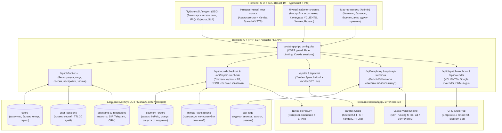

# Voxi.by 🇧🇾 — SaaS-платформа голосовых ИИ-администраторов для бизнеса в Беларуси

**Voxi.by** — высоконагруженная B2B SaaS-платформа голосовых ИИ-ассистентов для малого и среднего бизнеса в Республике Беларусь (автошколы, автосервисы и СТО, медицинские центры и стоматологии, салоны красоты). 

Платформа разворачивается на классическом стеке веб-хостинга РБ (**PHP 8.2+ / MySQL / ISPmanager / hoster.by**) и обеспечивает прием звонков с откликом до **0.5 сек** через SIP-транки белорусских операторов (**МТС**, **А1**, **Белтелеком IMS**).

---

## 🏗 Архитектура системы



---

## 🔒 Безопасность и соответствие законодательству РБ

1. **Закон РБ № 99-З «О защите персональных данных»**:
   - Обязательный баннер согласия на обработку cookie ([CookieConsentBanner.tsx](file:///Users/jmaxess/Desktop/telerobot/src/components/CookieConsentBanner.tsx)).
   - Автоматическое уведомление абонента о записи разговора в первой фразе ассистента ([botDialogueEngine.ts](file:///Users/jmaxess/Desktop/telerobot/src/lib/botDialogueEngine.ts)).
   - Полнотекстовые страницы документов `/privacy`, `/offer` (Публичный договор-оферта ИП), `/sla` (SLA 99.9%).
2. **Сессии и защита от XSS**:
   - Авторизационные токены хранятся исключительно в `HttpOnly`-cookie с флагами `SameSite=Strict` и `Secure`.
   - JavaScript не имеет доступа к токену сессии, в `localStorage` хранится лишь несекретный флаг `voxi_has_session`.
3. **Защита от CSRF**:
   - Функция `voxi_csrf_guard()` проверяет совпадение `Origin` / `Referer` с белым списком доменов (`voxi.by`, `www.voxi.by`, `localhost`).
   - Требуется обязательный кастомный заголовок `X-Requested-With: XMLHttpRequest` на всех мутирующих эндпоинтах.
4. **Контроль нагрузки (Rate Limiting)**:
   - Встроенный серверный rate limiter по скользящему окну (IP-адрес + действие):
     - `signin`: 10 попыток / мин
     - `signup`: 8 попыток / мин
     - `admin_login`: 5 попыток / мин
     - `tts`: 30 запросов / мин (защита квоты Yandex SpeechKit)
     - `chat`: 20 запросов / мин (защита квоты YandexGPT Lite)
     - `bepaid_checkout`: 10 запросов / мин
5. **Защита платежей (bePaid.by)**:
   - Сервер фиксирует заказ в таблице `payment_orders` до перехода в платежный шлюз.
   - Вебхук проверяет HTTP Basic Auth шлюза, статус `successful`, тип транзакции `payment`/`capture`.
   - Количество минут начисляется строго из серверного заказа, сверяется сумма в копейках и валюта (`BYN`).
   - Идемпотентность гарантируется блокировкой `SELECT ... FOR UPDATE` и уникальным индексом `external_uid`.
6. **Защита телефонного вебхука (Vapi.ai)**:
   - Обязательная криптографическая проверка секретного ключа `VAPI_WEBHOOK_SECRET` через `hash_equals()`.
   - Запросы без корректного секрета немедленно отклоняются кодом 401.

---

## 📂 Структура проекта

```text
.
├── index.html                  # HTML-шаблон с метатегами OpenGraph и предзагрузкой ассетов
├── vite.config.ts              # Конфигурация Vite, плагин React, сплиттинг вендорных чанков
├── tailwind.config.js          # Дизайн-система (шрифты Sofia Sans Extra Condensed, Inter, JetBrains Mono)
├── .htaccess                   # Конфиг Apache: маршрутизация SPA, кеширование, CSP и HSTS
├── .env.example                # Образец переменных окружения для хостинга
│
├── public/                     # Статические файлы, копируемые в корень dist/
│   ├── api/                    # Бэкенд на PHP 8.2+
│   │   ├── bootstrap.php       # Ядро API: PDO, сессии, rate limit, CSRF, миграции схемы БД
│   │   ├── config.php          # Чтение переменных окружения (.env / getenv)
│   │   ├── db.php              # REST-эндпоинты (аутентификация, профиль, звонки, админка)
│   │   ├── bepaid-checkout.php # Создание защищенного заказа и редирект в bePaid
│   │   ├── bepaid-webhook.php  # Обработка уведомлений bePaid (карты РБ, ЕРИП, возвраты)
│   │   ├── telephony.php       # WebRTC-симулятор звонка для тестов из браузера
│   │   ├── vapi-webhook.php    # Прием End-of-Call отчетов Vapi и списание минут
│   │   ├── tts.php             # Прокси-синтез Yandex SpeechKit TTS v1 с кешированием
│   │   ├── chat.php            # Генерация промтов и реплик через YandexGPT Lite
│   │   ├── calendar.php        # Интеграция с YCLIENTS и Google Calendar
│   │   └── dispatch-webhook.php# Пересылка лидов в CRM клиента (Битрикс24 / amoCRM)
│   ├── orbs/                   # Оптимизированные WebP-сферы для Hero-секции
│   ├── voices/                 # Аудио-семплы голосов (Анна, Дмитрий, Полина, Максим)
│   ├── sitemap.xml             # Карта сайта для поисковых систем (Yandex, Google)
│   └── robots.txt              # Директивы индексации (запрет /dashboard, /admin, /api/)
│
├── src/                        # Исходный код React 19 Frontend
│   ├── main.tsx                # Точка входа SPA, установка глобального CSRF-перехватчика
│   ├── App.tsx                 # Корневой роутер и синхронизация серверной сессии
│   ├── types/index.ts          # Строгие TypeScript интерфейсы платформы
│   ├── lib/
│   │   ├── ispDbClient.ts      # Клиент API личного кабинета и мастер-панели
│   │   ├── botDialogueEngine.ts# Диалоговый движок проверки доступности слотов
│   │   ├── defaultData.ts      # Отраслевые шаблоны (Автошкола, СТО, Медцентр, Салон)
│   │   ├── calendarSlotService.ts # Логика проверки свободных слотов онлайн-записи
│   │   ├── callerNotificationService.ts # Отправка SMS / Viber визиток клиенту
│   │   ├── speechSynth.ts      # Синтез и воспроизведение аудио
│   │   └── vapiService.ts      # Генерация системных промтов ассистента
│   └── components/
│       ├── Navbar.tsx          # Шапка лендинга с навигацией и кнопкой входа
│       ├── Footer.tsx          # Футер с реквизитами ИП в Минске и правовыми ссылками
│       ├── AuthModal.tsx       # Окно регистрации, входа и сброса пароля
│       ├── VoiceTestModal.tsx  # Интерактивное тестирование голосов по отраслям
│       ├── landing/            # Секции лендинга (Hero, FeatureShowcase, HowItWorks, Faq, Cta)
│       ├── admin/AdminPanel.tsx# Мастер-панель (#admin) с генерацией актов сдачи-приемки
│       └── dashboard/          # Личный кабинет (SimpleOverviewTab, SimpleAgentTab, CallLogsTab, IntegrationsTab)
│
└── scripts/                    # Скрипты автоматизации и тестирования
    ├── prerender.mjs           # SSG: headless-рендер страниц /, /offer, /privacy, /sla в HTML
    ├── verify_new_features.ts  # Интеграционные тесты слотов календаря и SMS-уведомлений
    ├── test_hydration.mjs      # E2E-тест гидратации React 19 в браузере Chrome
    └── test_admin_panel.mjs    # E2E-тест мастер-панели администратора (#admin)
```

---

## 🚀 Быстрый старт локально

### 1. Требования к окружению
- **Node.js**: 20.x или 22.x LTS
- **PHP**: 8.2+ с расширениями `pdo_mysql`, `curl`, `mbstring`, `openssl`, `json`
- **Google Chrome**: установлен локально (необходим для SSG-пререндеринга и тестов)

### 2. Установка зависимостей
```bash
npm install
```

### 3. Запуск сервера разработки
```bash
npm run dev
```
Фронтенд запустится на `http://localhost:5173`.

### 4. Запуск полного набора автотестов
```bash
npm test
```
Скрипт выполнит:
1. `test:features` — проверка логики слотов календаря, SMS-визиток и диалогового движка.
2. `test:hydration` — headless Chrome проверка отсутствия ошибок гидратации React 19 на всех маршрутах.
3. `test:admin_panel` — проверка защиты по PIN, входа в `#admin`, управления балансами и генерации актов.

### 5. Сборка для продакшена
```bash
npm run build
```
Команда компилирует TypeScript, собирает оптимизированный бандл Vite в папку `dist/` и выполняет статический SSG-пререндеринг страниц в HTML.

---

## 🛠 Развертывание в продакшен (ISPmanager / hoster.by)

### Шаг 1. Создание базы данных
1. В панели **ISPmanager** перейдите в **Базы данных** -> **Создать базу данных**.
2. Укажите имя БД (например, `voxi_db`), пользователя и надежный пароль (20+ символов).
3. Кодировка: `utf8mb4_unicode_ci`.
> **Примечание**: Таблицы БД создаются **автоматически** при первом HTTP-обращении благодаря встроенному механизму `voxi_ensure_schema()` в `bootstrap.php`.

### Шаг 2. Размещение файлов на хостинге
Сайт можно упаковать командой:
```bash
npm run pack:ispmanager
```
Архив `voxi-ispmanager.zip` загружается в корневую директорию сайта в ISPmanager (`www/voxi.by/`) и распаковывается.
Структура в директории домена:
```text
www/voxi.by/
├── index.html
├── .htaccess
├── api/
│   ├── bootstrap.php
│   ├── config.php
│   ├── db.php
│   └── ...
├── assets/
├── orbs/
├── voices/
└── ...
```

### Шаг 3. Настройка конфигурации `.env`
Создайте файл `.env` в директории `www/voxi.by/.env` (или на один уровень выше `www/.env` для максимальной безопасности):
```ini
# База данных MySQL ISPmanager
DB_HOST=localhost
DB_PORT=3306
DB_NAME=voxi_prod_db
DB_USER=voxi_prod_user
DB_PASS=StrongPassword_2026_Secure!

# Платежный шлюз bePaid.by
BEPAID_SHOP_ID=1234
BEPAID_SECRET_KEY=bepaid_secret_key_live_xyz
BEPAID_TEST_MODE=false
BEPAID_ERIP_SERVICE_NO=99999999
PUBLIC_SITE_URL=https://voxi.by

# Yandex SpeechKit + YandexGPT
YANDEX_API_KEY=AQVN_live_api_key_here
YANDEX_FOLDER_ID=b1g_folder_id_here

# Мастер-панель администратора
ADMIN_MASTER_PIN=SecretAdminPin9876!

# Телефония Vapi.ai
VAPI_API_KEY=vapi_private_key_here
VAPI_WEBHOOK_SECRET=vapi_strong_webhook_secret_here

# Почта SMTP для сброса паролей
SMTP_HOST=mail.voxi.by
SMTP_PORT=465
SMTP_USER=noreply@voxi.by
SMTP_PASS=smtp_mailbox_password
SMTP_FROM=noreply@voxi.by
SMTP_ENCRYPTION=ssl
```

### Шаг 4. Настройка SSL и веб-сервера
1. В ISPmanager подключите бесплатный SSL-сертификат **Let's Encrypt** с автопродлением.
2. В свойствах сайта убедитесь, что включена версия **PHP 8.2** или **PHP 8.3** в режиме **FastCGI (Apache)** или **LSAPI**.
3. Включите перенаправление с HTTP на HTTPS.

---

## 📋 Runbook: Эксплуатация и обслуживание

### 1. Резервное копирование БД
Настройте ежедневный cron-дамп MySQL в ISPmanager:
```bash
mysqldump -u voxi_prod_user -p'StrongPassword_2026_Secure!' voxi_prod_db | gzip > /var/backups/voxi_db_$(date +\%F).sql.gz
```
Хранить резервные копии не менее 30 дней.

### 2. Ротация секретных ключей
- **Смена ADMIN_MASTER_PIN**: обновляется в файле `.env`. Действующие сессии администратора немедленно инвалидируются.
- **Смена VAPI_WEBHOOK_SECRET**: обновляется одновременно в настройках ассистента в личном кабинете Vapi.ai и в файле `.env`.
- **Смена пароля БД**: обновляется в ISPmanager и в файле `.env`.

### 3. Мониторинг работоспособности
- **Проверка доступности API**: `curl -I https://voxi.by/api/db?action=me` (должен вернуть HTTP 200 или 401).
- **Проверка журналов ошибок Apache**: `/var/www/httpd-logs/voxi.by.error.log`.
- **Проверка журнала платежей**: таблица `payment_orders` (`status = 'paid'`, `status = 'mismatch'`).

---

## 📄 Юридические реквизиты оператора

- **Оператор**: Индивидуальный предприниматель Беляков Кирилл Олегович
- **УНП**: 193991846
- **Юридический адрес**: 220045, Республика Беларусь, г. Минск, ул. Наполеона Орды, д. 11, кв. 58
- **Банк**: ЗАО «Альфа-Банк», БИК ALFABY2X, р/с BY88ALFA30132G19399184600000
- **Email**: info@voxi.by
