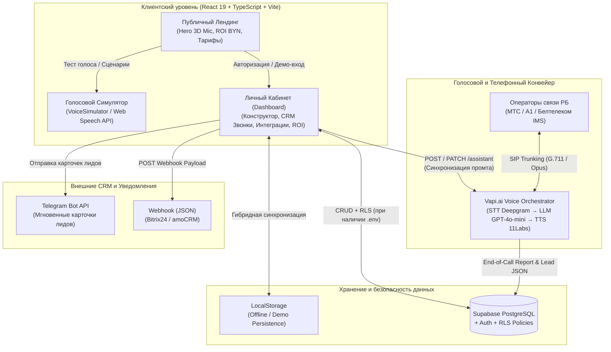

# Voxi.by 🇧🇾 — SaaS-платформа голосовых ИИ-администраторов для бизнеса в Беларуси

**Voxi.by** — полнофункциональная B2B SaaS-платформа (No-Code конструктор + CRM-панель + голосовой SIP-шлюз с честной поминутной оплатой), разработанная для малого и среднего бизнеса в Республике Беларусь (автошколы, СТО и автосервисы, стоматологии и медцентры, салоны красоты). Позволяет без участия программистов за 5 минут настроить и запустить телефонного голосового ИИ-администратора с откликом **0.5 секунды** на белорусских линиях **МТС**, **А1** и **Белтелеком (IMS)**.

---

## 🏗 Высокоуровневая архитектура системы



---

## 📂 Структура проекта

```text
/Users/jmaxess/Desktop/telerobot/
├── index.html                  # Точка входа HTML, подключение шрифтов (Sofia Sans Extra Condensed, Plus Jakarta Sans, Inter, JetBrains Mono)
├── tailwind.config.js          # Токены дизайн-системы Brutalist Editorial (цвета #e5e5e5, #d1ffca, #fff100, #4d49fc, шрифты)
├── src/
│   ├── main.tsx                # Инициализация React 19 Root
│   ├── App.tsx                 # Корневой контроллер состояния, маршрутизация Landing <-> Dashboard, синхронизация с localStorage
│   ├── index.css               # Глобальные стили, 3D-перспектива микрофона, анимация rainbowRotate (conic-gradient)
│   ├── types/
│   │   └── index.ts            # Строгая типизация доменных сущностей (AgentConfig, CallLog, SipSettings, UserSession и др.)
│   ├── lib/
│   │   ├── mockData.ts         # Отраслевые шаблоны РБ (Автошкола, СТО, Медцентр, Салон красоты) и демо-звонки
│   │   ├── vapiService.ts      # Генератор системных промтов (generateSystemPrompt) и REST-клиент Vapi API (syncWithVapiApi)
│   │   ├── speechSynth.ts      # Движок браузерного синтеза речи (VoiceSimulator) и генератор эквалайзера
│   │   └── supabaseClient.ts   # Инициализация клиента Supabase и флаг проверки окружения (isSupabaseConfigured)
│   ├── supabase/
│   │   └── schema.sql          # Продакшен SQL-схема таблиц PostgreSQL и политик Row Level Security (RLS)
│   └── components/
│       ├── Navbar.tsx          # Парящая капсула навигации (rounded-[48px]), переключатель Landing / Кабинет, мобильное меню
│       ├── Footer.tsx          # Бруталистский черный футер с контактами в Минске и модальными окнами (Закон № 99-З, Оферта, SLA)
│       ├── VoiceTestModal.tsx  # Модальный симулятор телефонного диалога с выбором ниши, голоса и быстрыми вопросами
│       ├── AuthModal.tsx       # Модальное окно входа/регистрации (Supabase Auth + быстрый 1-клик демо-вход)
│       ├── landing/            # Секции публичной витрины
│       │   ├── Hero.tsx            # Главный экран с живой консолью звонка и 3D-превью ИИ-администратора
│       │   ├── VoiceComparison.tsx # Интерактивное аудио-сравнение: Старый IVR-робот vs Voxi.by
│       │   ├── WhoIsItFor.tsx      # Отраслевые шаблоны Беларуси с предпросмотром промта и цен в BYN
│       │   ├── HowItWorks.tsx      # 3 шага запуска за 5 минут
│       │   ├── RoiCalculator.tsx   # Интерактивный калькулятор упущенной выручки и экономии ФОТ в BYN
│       │   ├── FeatureShowcase.tsx # 6 ключевых возможностей платформы
│       │   ├── Pricing.tsx         # Тарифная сетка в BYN (Старт 190, Бизнес 390, Сеть 690) с переключателем -20% за год
│       │   ├── FaqSection.tsx      # Инвертирующийся аккордеон ответов на частые вопросы
│       │   └── CtaSection.tsx      # Финальный Top-Arc блок (rounded-t-[64px])
│       └── dashboard/          # Модули личного кабинета клиента
│           ├── DashboardLayout.tsx # Оболочка кабинета, шапка со статусом SIP-линии и навигационные вкладки
│           ├── AgentBuilderTab.tsx # 3-шаговый конструктор ИИ-агента, редактор системного промта и синхронизация с Vapi.ai
│           ├── CallLogsTab.tsx     # Журнал звонков и CRM-лидов: поиск, фильтры, аудиоплеер записи, экспорт CSV, симуляция звонка
│           ├── IntegrationsTab.tsx # Настройка SIP-транка (МТС/А1), реальная отправка в Telegram Bot API, Webhook CRM и ключ Vapi
│           └── OverviewTab.tsx     # Сводная аналитика в BYN, воронка конверсии и чек-лист готовности
```

---

## 🎨 Дизайн-система (Monochrome Brutalist Editorial)

- **Палитра**: Строгий монохром — Белый основной фон (`#ffffff`), Угольно-черный (`#000000`) и оттенки серого (`#f5f5f5`, `#e5e5e5`, `#d4d4d4`, `#737373`, `#525252`, `#262626`).
- **Типографика**: `Sofia Sans Extra Condensed` (верхний регистр, `line-height: 0.90`, `letter-spacing: -0.03em`) для бруталистских заголовков + `Plus Jakarta Sans` / `Inter` для интерфейса + `JetBrains Mono` для системных меток.
- **Голосовой синтез и биллинг РБ**: Серверные функции Vercel (`/api/tts` на базе Yandex SpeechKit API v1, `/api/bepaid-checkout` и `/api/bepaid-webhook` для приёма платежей ЕРИП и карт через bePaid).

---

## 📦 Запуск проекта локально

1. Установите зависимости:
   ```bash
   npm install
   ```

2. Запустите локальный сервер разработки:
   ```bash
   npm run dev
   ```

3. Сборка для продакшена:
   ```bash
   npm run build
   ```
